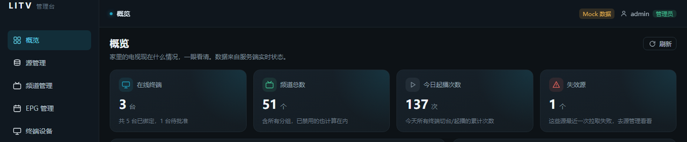
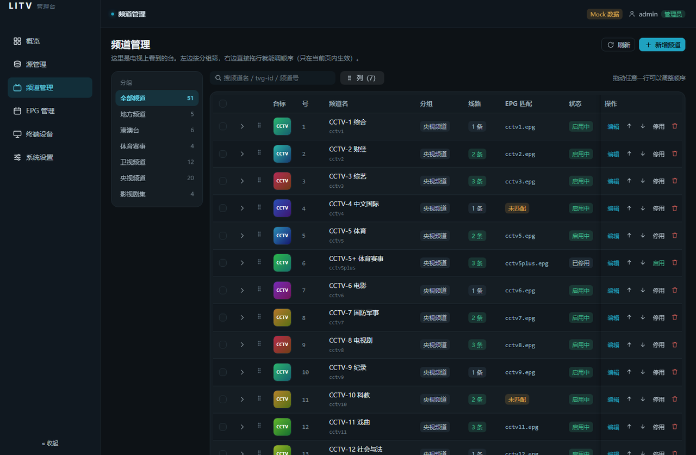
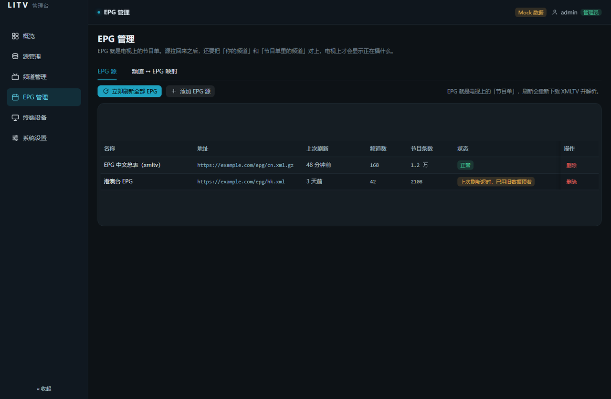
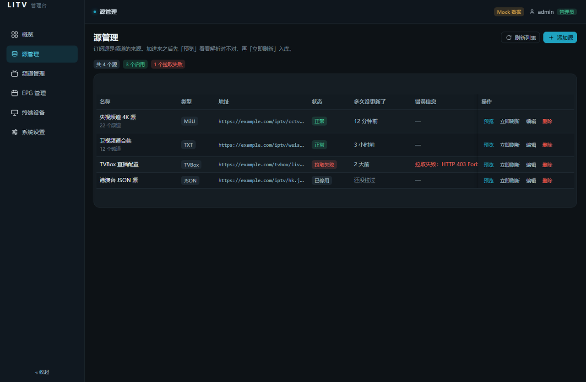
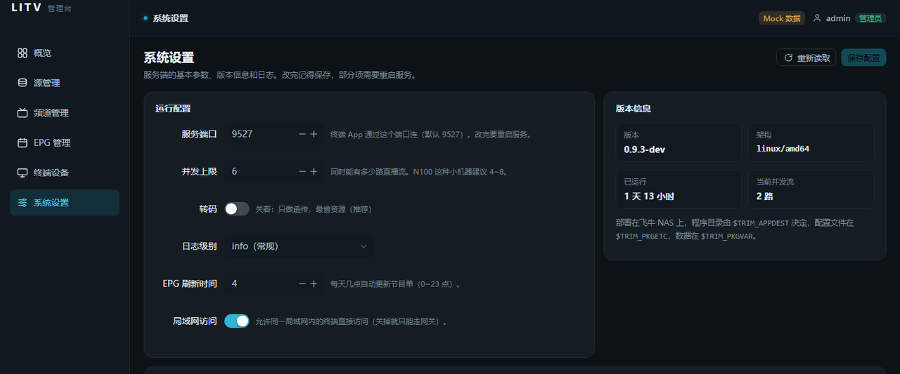
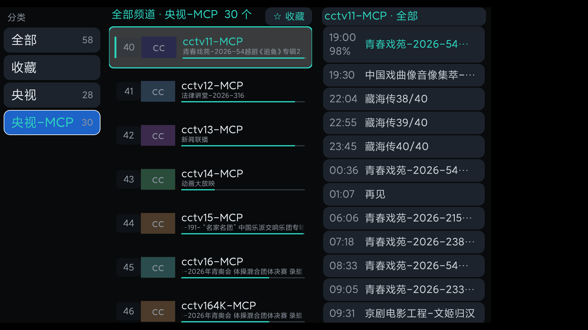
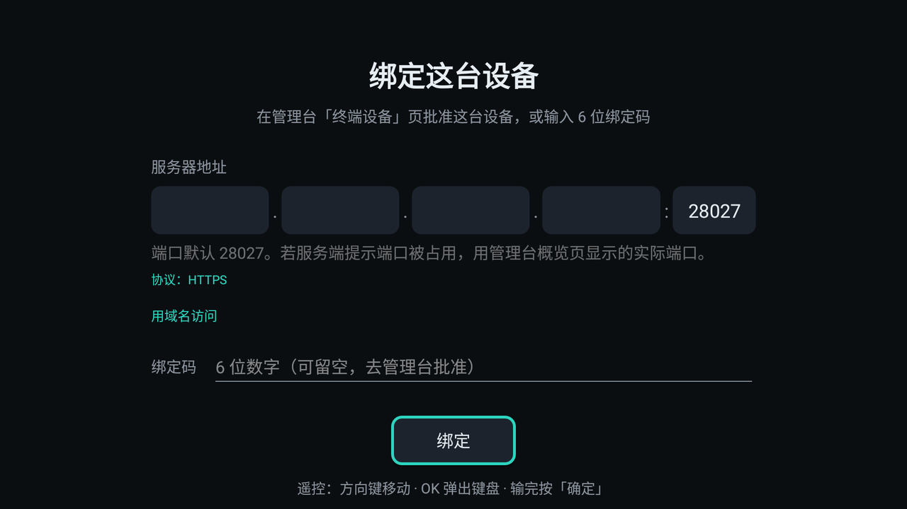
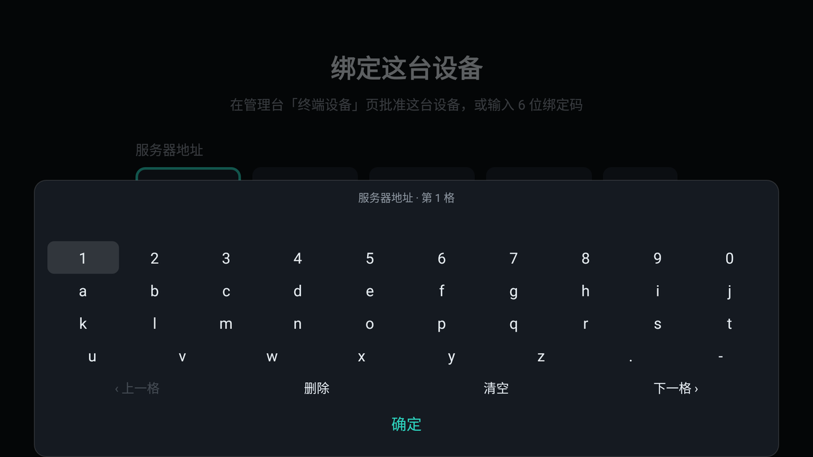
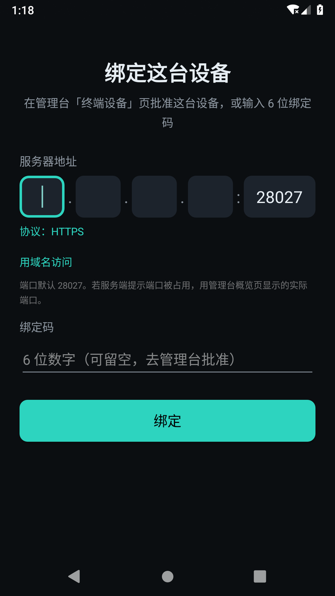

# LITV · IPTV 多终端管理平台

自建的 IPTV 源管理 + 播放平台，跑在飞牛 fnOS 上。
一套 Go 服务端带三端客户端：Android TV、Android 手机、iOS。

> **本仓库不提供、不内置、不托管任何直播源。**
> 所有源由使用者自行导入，合法性自负。

## 它能做什么

- **多源择优**：定期探测每条线路的健康度与延迟，某个台卡了自动换线路
- **流扇出**：3 台设备看同一个台只占 1 份上行带宽；新终端从最近的 GOP 起播
- **只转封装不转码**：裸 TS → HLS，几乎不吃 CPU
- **节目单**：XMLTV 定时刷新、自动匹配带置信度、未匹配诊断、开播提醒
- **回看与录制**：边看边录、时移回看、预约录制（`-c copy`）
- **投屏**：由 NAS 发 M-SEARCH 发现局域网渲染器，投的是服务端签名中转地址
- **手机当遥控器**：WebSocket 中转，跨网段可用，电视不用开端口
- **管理台**：Vue 3 + Naive UI，深色主题，含直播预览、设备审批、日志

## 界面

管理台是深色主题的单页应用。以下截图全部使用 **mock 数据**（右上角有「Mock 数据」标记），
不含真实地址与设备信息。

**概览** — 家里的电视现在什么情况，一眼看清：在线终端、频道总数、今日起播次数、失效源。

**频道管理** — 左侧按分组筛选，右侧表格显示台标、线路数、EPG 匹配状态；
拖动行即可调整顺序。

**EPG 管理** — 两个页签：EPG 源（拉取状态、上次刷新、节目条数）与频道 ↔ EPG 映射。
拉取失败的源会显示错误原文，不会静默失败。

**源管理** — 支持 M3U / TXT / TVBox / JSON 四种格式；每行显示拉取状态、
多久没更新、以及失败原因（例子里那条是上游返回 403）。

**系统设置** — 服务端口、并发上限、转码开关、日志级别、EPG 刷新时间、局域网访问；
右侧是版本与架构信息。改完记得保存，部分项需要重启服务。

## 客户端

三端共用同一套接口，界面形态按设备走：电视是遥控器 + 浮层，手机是竖屏列表，
iOS 是 SwiftUI。**TV 版和手机版是同一份代码、两个包名**，所以能同时装在一台设备上。

### 电视端

**频道浮层** — 三列并排：左边分类（全部 / 收藏 / 分组），中间频道（台号、台标、
正在播的节目与进度），右边当天节目单。方向键在列间移动，OK 切台。

**绑定页** — 遥控器输入服务器地址：四段 IP + 端口（默认 28027），
或切到「用域名访问」。也可以不填绑定码，直接在管理台批准。

**屏幕键盘** — 电视端没有触摸，地址是分段输入的。按 OK 弹出应用内键盘，
`上一格 / 下一格` 在四段 IP 与端口之间跳，输完按「确定」。

遥控器打字是电视端的真痛点——手机端没有这个问题，电视端必须给一套能用的屏幕键盘，
所以这一页的键位是单独调过的（左 = 频道页、右 = 设置菜单、OK = OSD、长按 OK = 线路选择）。

### 手机端与 iOS

手机端是竖屏列表 + 底部四个 Tab（播放 / 频道 / 遥控器 / 设置），
绑定页与电视端共用同一套逻辑，只是布局换成竖排。

| | 包名 | 界面 |
|---|---|---|
| 电视版 | `com.litv.tv` | 全屏播放 + 三列浮层 |
| 手机版 | `com.litv.tv.phone` | 竖屏列表 + 底部 Tab |
| iOS | `com.litv.tv`（自签） | SwiftUI，竖屏列表 + 底部 Tab |

界面形态优先级：设置里手动指定 > 安装的是哪个版本 > 设备特征自动判断，
所以手机版装到电视上不会跑成竖屏小窗。

> 上面三张图是在 Android 模拟器上跑当前构建实拍的，验证过程见
> [Android 模拟器验证](docs/design/03-Android模拟器验证.md)。iOS 端截图暂缺。

## 安装

1. **服务端**：飞牛「应用中心 → 手动安装」选对应架构的 `.fpk`（`x86_64` / `arm`），
   向导里填端口（默认 **28027**）、时区、是否允许局域网访问
2. **客户端**：打开后输入 `http://<NAS-IP>:28027`，拿到**绑定码**，
   到管理台「设备」页批准
3. 同一台设备重装 / 清数据**不需要重新批准**——客户端用系统稳定标识认回原设备

## 已知限制

- **iOS 只能由 CI 编译**，产物需自签
- **AV3A 音频**（AVS3-P3）解码库不随仓库分发，真机未验证出声；缺库时该链路不参与
- Android lint 目前只是报告模式，CI 绿不等于 lint 干净

## 文档

| 文档 | 内容 |
|---|---|
| [文档索引](docs/README.md) | 全部文档的分类与事实源优先级 |
| [总体方案](docs/design/00-总体方案.md) | 模块职责、三条主链路、CI 工作流 |
| [API 契约](docs/design/01-API.md) | 信封、错误码、认证三档、92 条路由 |
| [评审项状态](docs/review/STATUS.md) | 哪些已验证、哪些还没有 |
| [开发指南](AGENTS.md) | 工程约定与硬边界（改代码前必读） |
| [变更记录](CHANGELOG.md) | 每一版改了什么 |

## License

待定。注意：分发含 `libmpv`（GPL-2.0+）的 APK 会触发 GPL 义务，
`libvlc` 是 LGPL-2.1+，定 License 前需先理清这一条。
