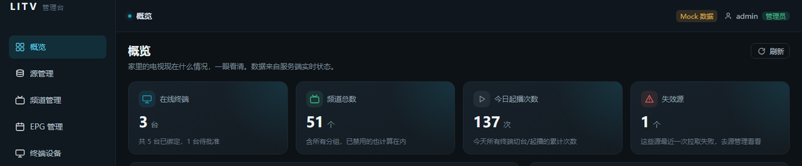
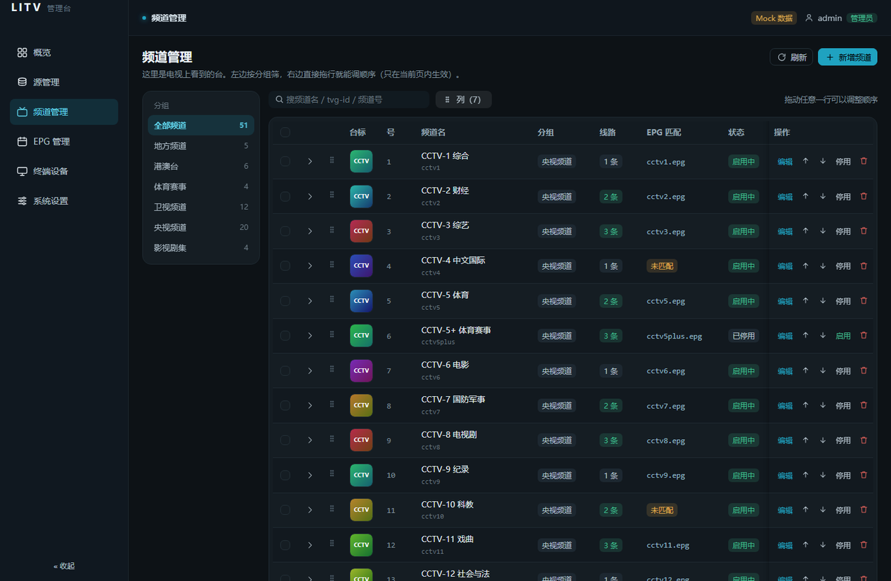
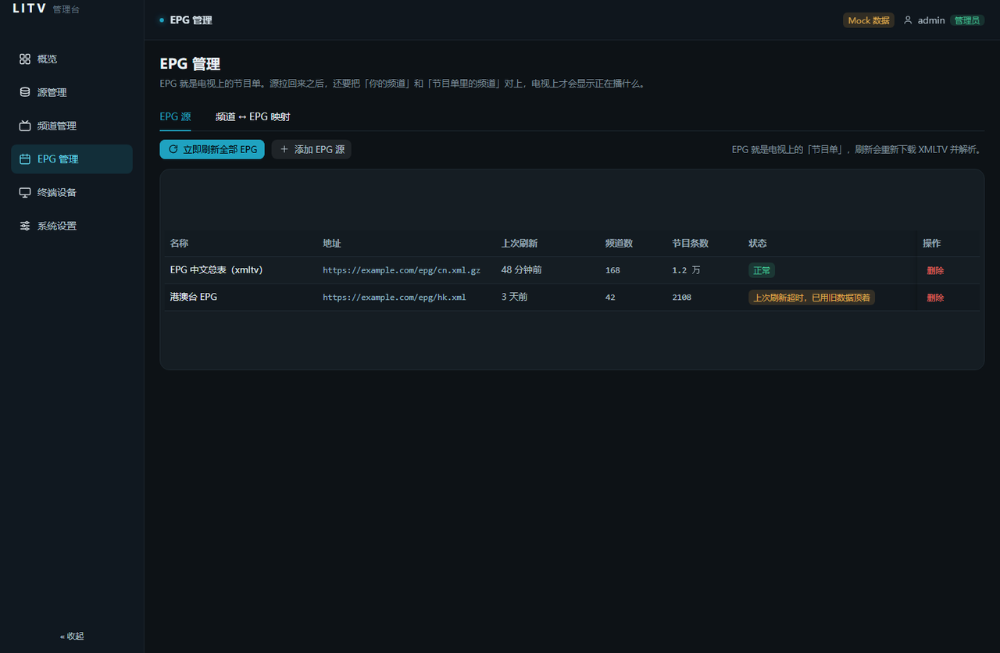
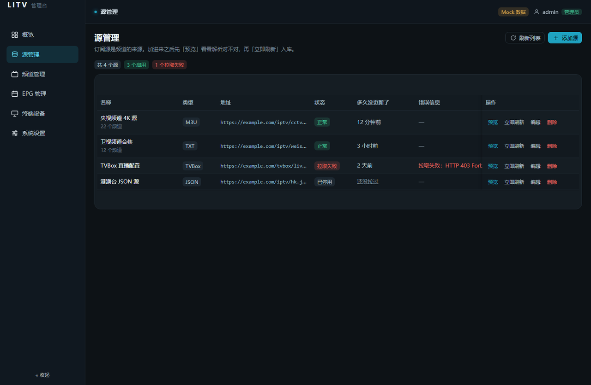
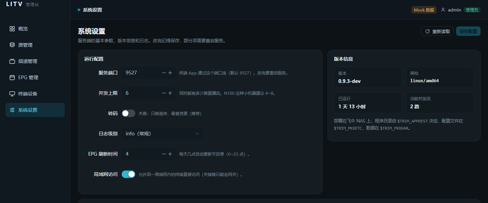
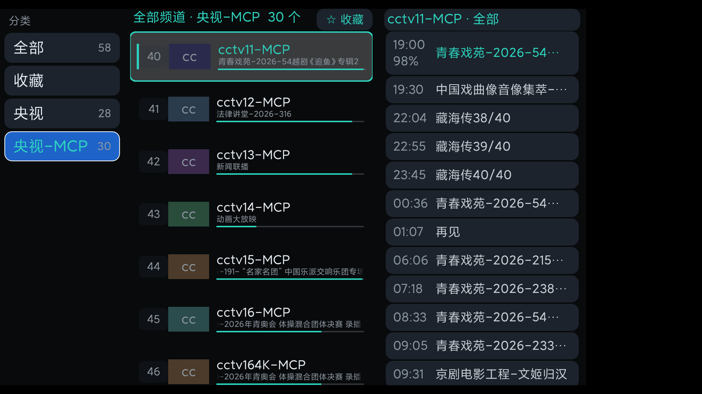
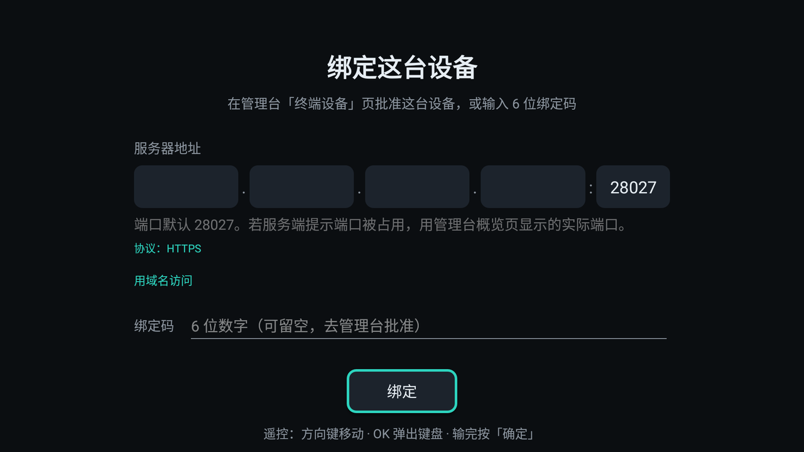
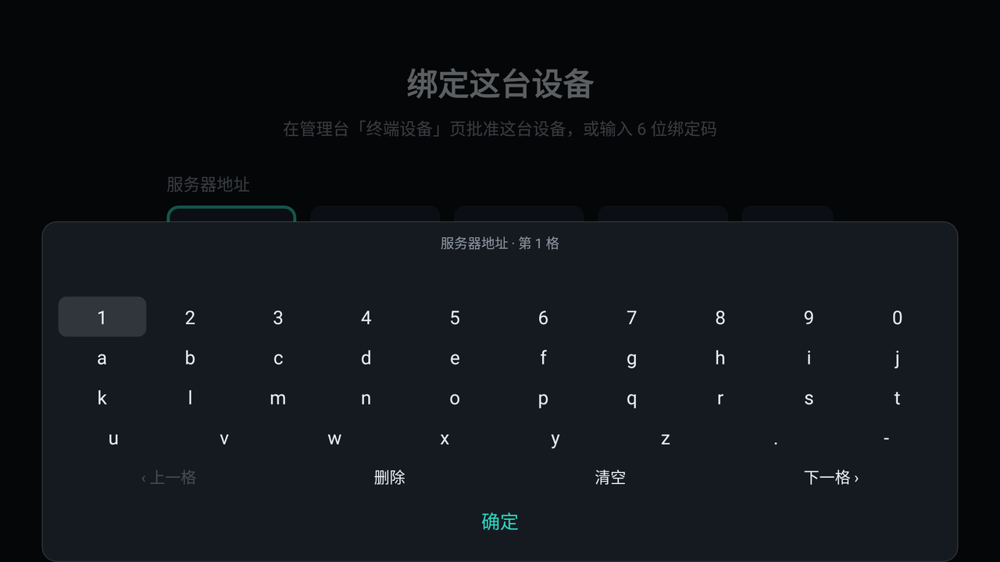
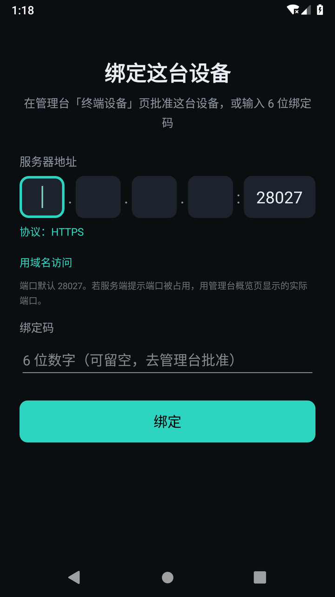

# LITV · IPTV 多终端管理平台

自建的 IPTV 源管理 + 播放平台。服务端可以装在飞牛 fnOS 上，
也可以直接用 Docker / 1Panel 部署。一套 Go 服务端带三端客户端：Android TV、Android 手机、iOS。

> **本仓库不提供、不内置、不托管任何直播源。**
> 所有源由使用者自行导入，合法性自负。

## 它能做什么

- **多源择优**：定期探测每条线路的健康度与延迟，某个台卡了自动换线路
- **流扇出**：3 台设备看同一个台只占 1 份上行带宽；新终端从最近的 GOP 起播
- **只转封装不转码**：裸 TS → HLS，几乎不吃 CPU
- **节目单**：XMLTV 定时刷新、自动匹配带置信度、未匹配诊断、开播提醒
- **回看与录制**：边看边录、时移回看、预约录制（`-c copy`）
- **投屏**：由 NAS 发 M-SEARCH 发现局域网渲染器，投的是服务端签名中转地址
- **手机当遥控器**：WebSocket 中转，跨网段可用，电视不用开端口
- **管理台**：Vue 3 + Naive UI，深色主题，含直播预览、设备审批、日志
- **屏蔽**：按分类整类挡或按频道名精确挡，点完立刻生效，客户端下次拉列表就收不到。
  这一页**只有边缘降级部署（Cloudflare Worker）有**——那边频道多、源每周都在加新台；
  只想藏一个台，用「源管理」里那一行的隐藏

## 界面

管理台是深色主题的单页应用。以下截图全部使用 **mock 数据**（右上角有「Mock 数据」标记），
不含真实地址与设备信息。

**概览** — 家里的电视现在什么情况，一眼看清：在线终端、频道总数、今日起播次数、失效源。



**频道管理** — 左侧按分组筛选，右侧表格显示台标、线路数、EPG 匹配状态；
拖动行即可调整顺序。



**EPG 管理** — 两个页签：EPG 源（拉取状态、上次刷新、节目条数）与频道 ↔ EPG 映射。
拉取失败的源会显示错误原文，不会静默失败。



**源管理** — 支持 M3U / TXT / TVBox / JSON 四种格式；每行显示拉取状态、
多久没更新、以及失败原因（例子里那条是上游返回 403）。



**系统设置** — 服务端口、并发上限、转码开关、日志级别、EPG 刷新时间、局域网访问；
右侧是版本与架构信息。改完记得保存，部分项需要重启服务。



## 客户端

三端共用同一套接口，界面形态按设备走：电视是遥控器 + 浮层，手机是竖屏列表，
iOS 是 SwiftUI。

**Android 是同一份代码、一个包（`com.litv.tv`）**，界面形态由「界面模式」（默认 auto）
按设备自动选择；发布时只按 ABI 拆包（arm64-v8a / armeabi-v7a），不按电视/手机拆。

### 电视端

**频道浮层** — 三列并排：左边分类（全部 / 收藏 / 分组），中间频道（台号、台标、
正在播的节目与进度），右边当天节目单。方向键在列间移动，OK 切台。



**绑定页** — 遥控器输入服务器地址：四段 IP + 端口（默认 28027），
或切到「用域名访问」。也可以不填绑定码，直接在管理台批准。



**屏幕键盘** — 电视端没有触摸，地址是分段输入的。按 OK 弹出应用内键盘，
`上一格 / 下一格` 在四段 IP 与端口之间跳，输完按「确定」。



遥控器打字是电视端的真痛点——手机端没有这个问题，电视端必须给一套能用的屏幕键盘，
所以这一页的键位是单独调过的（左 = 频道页、右 = 设置菜单、OK = OSD、长按 OK = 线路选择）。

### 手机端与 iOS

手机端是竖屏列表 + 底部四个 Tab（播放 / 频道 / 遥控器 / 设置），
绑定页与电视端共用同一套逻辑，只是布局换成竖排。



| | 包名 | 界面 |
|---|---|---|
| Android（电视） | `com.litv.tv` | 全屏播放 + 三列浮层 |
| Android（手机） | `com.litv.tv`（同一个包） | 竖屏列表 + 底部 Tab |
| iOS | `com.litv.tv`（自签） | SwiftUI，竖屏列表 + 底部 Tab |

界面形态优先级：设置里手动指定 > 设备特征自动判断。同一个包装在电视上走电视界面，
装在手机上走竖屏界面。

**播放**：Media3（Exo）为主，VLC 兜底；mpv 需要对应的 `.so`，多数 ABI 上没有，
实际可用的是 Exo → VLC 两级。画面比例可选自动 / 16:9 / 4:3 / 拉伸 / 裁切，
电视、手机竖屏、全屏三处同一套逻辑。退到后台即停播，应用内切页不停。

> 上面三张图是在 Android 模拟器上跑当前构建实拍的，验证过程见
> [Android 模拟器验证](docs/design/03-Android模拟器验证.md)。iOS 端截图暂缺。

## 安装

### Docker / 1Panel（推荐，公网可直接用）

一条命令装好：默认拉最新正式版镜像、只绑 `127.0.0.1:28027`（对外交给
1Panel 反代），数据落在 `/opt/litv/data`。装完打开页面，**第一次会要求你
自己设一个管理密码**——没有默认口令。

```bash
curl -fsSL https://raw.githubusercontent.com/ybd156/litv/main/scripts/install.sh | bash
```

装完接客户端：客户端里填 `http://<服务器IP>:28027`，会拿到一个**绑定码**，
到管理台「设备」页批准即可。同一台设备重装 / 清数据不用重新批准——
客户端用系统稳定标识认回原设备。

卸载（连数据一起删；只想卸程序保留数据就去掉 `--purge`）：

```bash
curl -fsSL https://raw.githubusercontent.com/ybd156/litv/main/scripts/uninstall.sh | bash -s -- --purge
```

装完顺手记两个命令：`litv status` 看版本与健康、`litv upgrade` 升到最新。

1Panel 里建反向代理指向 `http://127.0.0.1:28027`，高级配置加两行：

```nginx
proxy_read_timeout 3600s;
proxy_buffering off;
```

要指定版本、开自动升级、备份与排错，见 [1Panel 部署](docs/deploy/1panel.md)。

### 飞牛 fnOS

1. **服务端**：飞牛「应用中心 → 手动安装」选对应架构的 `.fpk`（`x86_64` / `arm`），
   向导里填端口（默认 **28027**）、时区、是否允许局域网访问
2. **客户端**：打开后输入 `http://<NAS-IP>:28027`，拿到**绑定码**，
   到管理台「设备」页批准
3. 同一台设备重装 / 清数据**不需要重新批准**——客户端用系统稳定标识认回原设备

## 加密 DNS（DoH）

Android 端在 App 内自带 DoH（设置里可开关，失败回落系统 DNS，并把上次解析结果落盘，
网络抖动时用旧地址直连）。

**iOS 端不做 App 内 DoH**，改用系统原生能力，更彻底也更省事：

> iOS 14 起支持「加密 DNS」。装一个 DoH 描述文件（阿里 `223.5.5.5`、
> 腾讯 `1.12.12.12` 等都有公开的 `.mobileconfig`），在
> 「设置 → 通用 → VPN与设备管理」里安装，再到「设置 → 无线局域网 →
> 当前网络 → 配置 DNS → 加密 DNS」选它即可。装完对**所有 App** 生效。

不做 App 内实现的原因：`URLSession` 没有 DNS 钩子，唯一正路是
`NEDNSProxyProvider`（Network Extension target + entitlement + 用户手动启用），
成本高于收益；而绕过 DNS 自己连 IP 的做法在 HTTPS 上必然要碰证书校验，
那是 AGENTS §6 明令禁止的。

## 已知限制

- **iOS 只能由 CI 编译**，产物需自签
- **AV3A 音频**（AVS3-P3）解码库不随仓库分发，真机未验证出声；缺库时该链路不参与
- Android lint 目前只是报告模式，CI 绿不等于 lint 干净

## 文档

| 文档 | 内容 |
|---|---|
| [文档索引](docs/README.md) | 全部文档的分类与事实源优先级 |
| [总体方案](docs/design/00-总体方案.md) | 模块职责、三条主链路、CI 工作流 |
| [1Panel 部署](docs/deploy/1panel.md) | Docker 部署、选版本、自动升级、卸载与排错 |
| [API 契约](docs/design/01-API.md) | 信封、错误码、认证三档、92 条路由 |
| [评审项状态](docs/review/STATUS.md) | 哪些已验证、哪些还没有 |
| [开发指南](AGENTS.md) | 工程约定与硬边界（改代码前必读） |
| [变更记录](CHANGELOG.md) | 每一版改了什么 |

## License

待定。注意：分发含 `libmpv`（GPL-2.0+）的 APK 会触发 GPL 义务，
`libvlc` 是 LGPL-2.1+，定 License 前需先理清这一条。
